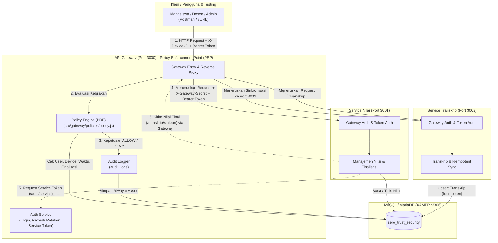

# Zero Trust Security — Sistem Layanan Nilai Akademik

Proyek Praktikum Keamanan Informasi yang mengimplementasikan arsitektur keamanan **Zero Trust Security** ("*Never Trust, Always Verify*") pada sistem akademik kampus berbasis Microservices (*Node.js & Express.js*) dan database *MySQL/MariaDB* melalui XAMPP.

---

## 1. Tujuan Implementasi Zero Trust

Arsitektur tradisional berbasis perimeter (*Castle-and-Moat*) mengasumsikan bahwa entitas di dalam jaringan lokal (misalnya `localhost` atau intranet kampus) secara otomatis dapat dipercaya. Paradigma tersebut rentan terhadap pergerakan lateral penyerang (*lateral movement*) dan penyalahgunaan hak akses internal.

Melalui arsitektur **Zero Trust**, sistem ini menerapkan prinsip:
1. **Verifikasi Eksplisit (*Explicit Verification*)**: Setiap permintaan (*request*) wajib mengotentikasi dan mengotorisasi identitas subjek (*User/Service*), perangkat terdaftar (*Device Verification*), serta integritas token (*JWT Signature & Expiry*).
2. **Hak Akses Terkecil (*Least Privilege Access*)**: Pengguna hanya memiliki wewenang untuk membaca dan memanipulasi data miliknya sendiri atau kelas yang diampunya.
3. **Asumsi Terjadinya Pembobolan (*Assume Breach*)**: Service internal (*Service Nilai* & *Service Transkrip*) tidak mempercayai request hanya karena berasal dari `localhost`. Service internal mewajibkan header rahasia gateway (*X-Gateway-Secret*) serta memverifikasi ulang tanda tangan JWT secara mandiri (*Defense-in-Depth*).
4. **Pemisahan Jalur Komunikasi Antar-Service**: Endpoint sinkronisasi transkrip menolak seluruh access token pengguna (*user tokens*), dan hanya menerima Service Token resmi yang diterbitkan melalui pertukaran kredensial client service.
5. **Kebijakan Waktu Akses (*Time-based Policy*)**: Operasi kritis seperti perubahan nilai dan finalisasi kelas dibatasi hanya pada jam operasional akademik resmi (07.00 – 21.00 WIB).
6. **Audit Komprehensif (*Comprehensive Auditing*)**: Setiap keputusan akses, baik yang diizinkan (`ALLOW`) maupun ditolak (`DENY`), dicatat ke dalam tabel audit log tanpa pernah membocorkan kredensial atau rahasia.

---

## 2. Diagram Arsitektur Sistem

Arsitektur sistem terdiri dari **API Gateway (Port 3000)** yang terintegrasi dengan **Policy Engine (PDP/PEP)**, **Service Nilai (Port 3001)**, dan **Service Transkrip (Port 3002)**.



---

## 3. Komponen dan Peran Layanan

### A. API Gateway & Policy Engine (Port 3000)
- **Policy Enforcement Point (PEP)**: Satu-satunya pintu gerbang akses publik bagi pengguna.
- **Policy Engine (PDP)** diimplementasikan pada `src/gateway/policies/policy.js`.
- Memeriksa identitas subjek, validitas perangkat terdaftar (`X-Device-ID`), status finalisasi, dan pembatasan jam operasional (07.00 - 21.00 WIB).
- Menyuntikkan header rahasia internal `X-Gateway-Secret` saat meneruskan request yang sah ke microservice terkait.
- Mencatat seluruh keputusan otorisasi ke tabel `audit_logs`.

### B. Service Nilai (Port 3001)
- Bertanggung jawab atas pengelolaan entitas nilai akademik (`grades`) dan status kelas (`classes`).
- Memverifikasi keberadaan dan keabsahan `X-Gateway-Secret` serta melakukan verifikasi mandiri tanda tangan JWT.
- Memastikan dosen hanya dapat mengelola nilai pada kelas yang diampunya, dan menolak pengubahan pada kelas yang telah difinalisasi.
- Menginisiasi sinkronisasi transkrip antar-service setelah finalisasi berhasil menggunakan Service Token.

### C. Service Transkrip (Port 3002)
- Mengelola data transkrip akademik mahasiswa (`transcripts`).
- Menerapkan mekanisme sinkronisasi idempoten (`ON DUPLICATE KEY UPDATE`) sehingga request berulang tidak menyebabkan data duplikat.
- Mengizinkan mahasiswa hanya melihat transkrip miliknya sendiri, dan menolak akses dosen secara langsung.
- Memastikan endpoint `/transkrip/sinkron` **hanya dapat diakses oleh Service Nilai dengan Service Token valid** dan secara tegas menolak token pengguna (*user access token*).

---

## 4. Teknologi yang Digunakan

- **Runtime**: Node.js (v18+)
- **Framework**: Express.js (v4)
- **Database**: MySQL / MariaDB via XAMPP
- **Database Driver**: `mysql2/promise` (Prepared Statements & Transactions)
- **Keamanan & Kriptografi**:
  - `jsonwebtoken` (Pembuatan & verifikasi tanda tangan Access, Refresh, dan Service Token)
  - `bcryptjs` (Hashing password akun pengguna)
  - `crypto` (Hashing SHA-256 untuk Refresh Token & UUID Request-ID)
  - `helmet` (HTTP Security Headers)
  - `express-rate-limit` (Proteksi Brute-force pada endpoint autentikasi)
- **Testing**: Jest & Supertest (Automated Testing 38 Skenario)
- **API Client**: Postman (Collection & Environment)

---

## 5. Persyaratan Instalasi dan Persiapan Lingkungan

1. Komputer bersistem operasi Windows.
2. XAMPP terinstal (Apache & MySQL).
3. Node.js (v18 ke atas) dan npm terinstal.

### A. Menyalakan MySQL di XAMPP
1. Buka **XAMPP Control Panel**.
2. Klik tombol **Start** pada modul **MySQL** (dan Apache jika ingin membuka phpMyAdmin).
3. Pastikan port status menunjukkan hijau dan aktif pada port default `3306`.

### B. Konfigurasi Database Melalui phpMyAdmin (Opsional)
Aplikasi ini sudah menyediakan skrip otomatis untuk membuat database dan tabel. Namun jika ingin memeriksa via antarmuka visual:
1. Buka browser dan arahkan ke: `http://localhost/phpmyadmin/`.
2. Database bernama `zero_trust_security` akan muncul setelah skrip inisialisasi dijalankan.

---

## 6. Langkah-Langkah Menjalankan Proyek

### Langkah 1: Klon / Buka Direktori Proyek
Buka terminal PowerShell pada direktori proyek:
```powershell
cd "d:\SEMESTER 5\KEAMANAN INFORMASI\Tugas Praktikum Zero Trust Security"
```

### Langkah 2: Konfigurasi Environment (`.env`)
Salin file template `.env.example` menjadi `.env`:
```powershell
Copy-Item .env.example .env
```
Buka file `.env` dan sesuaikan kredensial database XAMPP Anda:
```env
DB_HOST=127.0.0.1
DB_PORT=3306
DB_NAME=zero_trust_security
DB_USER=root
DB_PASSWORD=

GATEWAY_PORT=3000
NILAI_PORT=3001
TRANSKRIP_PORT=3002

JWT_ACCESS_SECRET=zt_access_secret_key_production_grade_32_bytes_min_abc123
JWT_REFRESH_SECRET=zt_refresh_secret_key_production_grade_32_bytes_min_def456
JWT_SERVICE_SECRET=zt_service_secret_key_production_grade_32_bytes_min_ghi789
GATEWAY_SECRET=zt_internal_gateway_secret_header_trust_token_jkl012

SERVICE_NILAI_CLIENT_ID=service-nilai
SERVICE_NILAI_CLIENT_SECRET=secret-credential-for-nilai-service-sync-2026

ACCESS_START_HOUR=7
ACCESS_END_HOUR=21
TIME_ZONE=Asia/Jakarta
```

> **Catatan Konfigurasi:** Jika instalasi XAMPP Anda menggunakan password root MySQL, masukkan password tersebut pada nilai `DB_PASSWORD`.

### Langkah 3: Menginstal Dependencies
Jalankan perintah instalasi paket npm:
```powershell
npm install
```

### Langkah 4: Inisialisasi Database dan Seed Data
Jalankan skrip migrasi database otomatis untuk membuat seluruh tabel dan memasukkan data demo awal:
```powershell
npm run db:setup
```

Untuk memverifikasi bahwa database dan seluruh tabel telah terisi dengan benar:
```powershell
npm run db:test
```

### Langkah 5: Menjalankan Seluruh Service
Anda dapat menjalankan ketiga service secara sekaligus dalam satu terminal menggunakan perintah:
```powershell
npm start
```
*Atau* jika ingin menjalankan masing-masing service pada terminal terpisah:
- **Terminal 1 (API Gateway)**: `npm run start:gateway` (Port 3000)
- **Terminal 2 (Service Nilai)**: `npm run start:nilai` (Port 3001)
- **Terminal 3 (Service Transkrip)**: `npm run start:transkrip` (Port 3002)

---

## 7. Akun Demo dan Kredensial Pengujian

Seluruh akun demo di bawah ini menggunakan password default: **`Password123!`** (disimpan dalam bentuk bcrypt hash di database).

| Role | Nama Pengguna | Email | Device ID Terdaftar | Keterangan |
|---|---|---|---|---|
| **Admin** | Administrator Akademik | `admin@kampus.ac.id` | `DEV-ADMIN-01` | Hak akses melihat seluruh transkrip & audit logs |
| **Lecturer** | Dr. Budi Santoso, M.Kom. | `dosen1@kampus.ac.id` | `DEV-DOSEN-01` | Dosen Pengampu Kelas 1 (`TIF-301`) |
| **Lecturer** | Dr. Siti Aminah, M.T. | `dosen2@kampus.ac.id` | `DEV-DOSEN-02` | Dosen Pengampu Kelas 2 (`TIF-302`) |
| **Student** | Ahmad Fauzi | `mhs1@kampus.ac.id` | `DEV-MHS-01` | NIM: `2021001`, Terdaftar di Kelas 1 |
| **Student** | Bunga Citra | `mhs2@kampus.ac.id` | `DEV-MHS-02` | NIM: `2021002`, Terdaftar di Kelas 1 & 2 |
| **Student** | Candra Wijaya | `mhs3@kampus.ac.id` | `DEV-MHS-03` | NIM: `2021003`, Terdaftar di Kelas 2 |
| **Student (Revoked Device)** | Ahmad Fauzi | `mhs1@kampus.ac.id` | `DEV-MHS-REVOKED` | Perangkat dinonaktifkan (`is_active = 0`) |
| **Student (Inactive User)** | Akun Nonaktif | `inactive@kampus.ac.id` | `DEV-INACTIVE-01` | Akun dinonaktifkan (`is_active = 0`) |

---

## 8. Ringkasan Endpoint API

Semua request pengguna harus dikirim ke **API Gateway pada port 3000**.

| Method | Endpoint | Wajib Header | Wajib Role / Token | Deskripsi |
|---|---|---|---|---|
| `GET` | `/health` | - | Publik | Health check status API Gateway |
| `POST` | `/auth/login` | `X-Device-ID` | Publik | Otentikasi user & device, menerbitkan access & refresh token |
| `POST` | `/auth/refresh` | - | Body: `refreshToken` | Rotasi atomik refresh token lama ke baru |
| `POST` | `/auth/logout` | - | Body: `refreshToken` | Mencabut refresh token di database |
| `POST` | `/auth/service` | - | Client Credential | Menerbitkan Service Token untuk komunikasi antar-service |
| `GET` | `/nilai` | `X-Device-ID`, `Authorization` | Student / Lecturer / Admin | Melihat nilai sesuai batas kepemilikan data |
| `PUT` | `/nilai/:id` | `X-Device-ID`, `Authorization` | Lecturer (Pengampu) | Mengubah nilai mahasiswa (hanya 07.00 - 21.00 WIB & belum final) |
| `POST` | `/kelas/:id/finalisasi` | `X-Device-ID`, `Authorization` | Lecturer (Pengampu) | Finalisasi kelas dan memicu sinkronisasi transkrip otomatis |
| `GET` | `/transkrip/:nim` | `X-Device-ID`, `Authorization` | Student (Milik Sendiri) / Admin | Melihat transkrip akademik berdasarkan NIM |
| `POST` | `/transkrip/sinkron` | `Authorization` | Service Token (`service-nilai`) | Sinkronisasi data nilai ke transkrip secara idempoten |
| `GET` | `/audit-logs` | `X-Device-ID`, `Authorization` | Admin | Melihat riwayat keputusan audit log keamanan |

---

## 9. Menjalankan Automated Tests (Jest)

Aplikasi dilengkapi pengujian otomatis yang mencakup 38 skenario keamanan Zero Trust (Autentikasi, Rotasi Token, Validasi Perangkat, Otorisasi Nilai, Jam Akses, Finalisasi, Transkrip, dan Audit Log).

Jalankan pengujian dengan perintah:
```powershell
npm test
```

### Hasil Ringkasan Pengujian:
- `tests/auth.test.js` (11 Test): Lulus 100%
- `tests/device.test.js` (4 Test): Lulus 100%
- `tests/nilai.test.js` (8 Test): Lulus 100%
- `tests/transkrip.test.js` (10 Test): Lulus 100%
- `tests/policy.test.js` (5 Test): Lulus 100%
- **Total: 38 Passed, 0 Failed**

---

## 10. Pengujian Menggunakan Postman

File koleksi dan environment Postman telah disediakan di dalam folder `postman/`:
1. `postman/Zero-Trust-Security.postman_collection.json`
2. `postman/Zero-Trust-Security.postman_environment.json`

### Cara Mengimpor ke Postman:
1. Buka aplikasi **Postman**.
2. Klik tombol **Import** pada pojok kiri atas.
3. Pilih kedua file JSON dari folder `postman/`.
4. Pada pojok kanan atas Postman, pilih environment aktif: **"Zero Trust Security Environment"**.
5. Nilai variabel `accessToken`, `refreshToken`, dan `serviceToken` akan otomatis terisi saat menjalankan request login atau penerbitan token berkat skrip test otomatis di Postman.

---

## 11. Skenario Demonstrasi Praktikum (Video Walkthrough)

Ikuti urutan demonstrasi berikut untuk membuktikan penegakan prinsip Zero Trust:

### Skenario 1: Bukti Verifikasi Identitas & Perangkat (Login)
1. **Login Berhasil (ALLOW)**:
   - Kirim `POST /auth/login` dengan email `dosen1@kampus.ac.id`, password `Password123!`, dan header `X-Device-ID: DEV-DOSEN-01`.
   - **Hasil**: HTTP 200 OK, Access Token dan Refresh Token diterbitkan.
2. **Login Ditolak Tanpa Device (DENY)**:
   - Hapus header `X-Device-ID`.
   - **Hasil**: HTTP 400 Bad Request ("Header X-Device-ID wajib disertakan").
3. **Login Ditolak Device Tidak Terdaftar (DENY)**:
   - Pasang header `X-Device-ID: DEV-ILEGAL-999`.
   - **Hasil**: HTTP 403 Forbidden ("Device ID tidak terdaftar untuk identitas pengguna ini").
4. **Login Ditolak Device Dinonaktifkan (DENY)**:
   - Login dengan email `mhs1@kampus.ac.id` menggunakan `X-Device-ID: DEV-MHS-REVOKED`.
   - **Hasil**: HTTP 403 Forbidden ("Perangkat dalam status dinonaktifkan").

### Skenario 2: Bukti Pembatasan Kepemilikan Data Nilai
1. **Mahasiswa Melihat Nilai Sendiri (ALLOW)**:
   - Login sebagai `mhs1@kampus.ac.id`, lalu kirim `GET /nilai` dengan token dan device Ahmad Fauzi.
   - **Hasil**: HTTP 200 OK, hanya menampilkan nilai milik Ahmad Fauzi (student_id: 4).
2. **Mahasiswa Ditolak Mengubah Nilai (DENY)**:
   - Menggunakan token mahasiswa, kirim `PUT /nilai/1` dengan body `{"score": 100}`.
   - **Hasil**: HTTP 403 Forbidden ("Hanya dosen pengampu yang berhak mengubah nilai").
3. **Dosen Ditolak Mengubah Nilai Kelas Lain (DENY)**:
   - Login sebagai Dr. Budi (`dosen1@kampus.ac.id`, pengampu Kelas 1), lalu kirim `PUT /nilai/3` (nilai ID 3 milik Kelas 2 yang diampu Dr. Siti).
   - **Hasil**: HTTP 403 Forbidden ("Anda bukan dosen pengampu untuk kelas ini").

### Skenario 3: Bukti Kebijakan Waktu Akses (Time-based Policy)
1. **Perubahan Nilai Dalam Jam Operasional (ALLOW)**:
   - Kirim `PUT /nilai/1` oleh Dosen 1 pada jam 07.00 - 21.00 WIB.
   - **Hasil**: HTTP 200 OK, nilai terupdate.
2. **Perubahan Nilai Di Luar Jam Operasional (DENY)**:
   - Tambahkan header simulasi waktu malam: `X-Test-Time-Override: 2026-10-29T23:30:00+07:00`.
   - **Hasil**: HTTP 403 Forbidden ("Operasi ditolak di luar jam operasional akademik 7.00 - 21.00 WIB").

### Skenario 4: Bukti Finalisasi Kelas & Sinkronisasi Antar-Service
1. **Finalisasi Kelas oleh Dosen Pengampu (ALLOW)**:
   - Kirim `POST /kelas/1/finalisasi` oleh Dosen 1.
   - **Hasil**: HTTP 200 OK. Kelas terkunci (`is_finalized = 1`), Service Nilai meminta Service Token dan menyinkronkan seluruh nilai ke Service Transkrip.
2. **Perubahan Nilai Setelah Finalisasi Ditolak (DENY)**:
   - Coba ubah kembali nilai kelas 1 (`PUT /nilai/1`).
   - **Hasil**: HTTP 403 Forbidden ("Nilai tidak dapat diubah karena kelas sudah difinalisasi").
3. **Sinkronisasi Ditolak Menggunakan User Token (DENY)**:
   - Coba kirim `POST /transkrip/sinkron` menggunakan User Token Admin atau Dosen.
   - **Hasil**: HTTP 403 Forbidden ("User access token ditolak pada endpoint sinkronisasi. Hanya Service Token yang diizinkan").
4. **Perlindungan Service Internal (DENY)**:
   - Akses langsung Service Transkrip di port 3002 (`http://localhost:3002/transkrip/2021001`) tanpa `X-Gateway-Secret`.
   - **Hasil**: HTTP 403 Forbidden ("Permintaan tidak melalui API Gateway resmi atau secret tidak valid").

### Skenario 5: Bukti Transparansi Audit Logging
1. Kirim `GET /audit-logs` menggunakan token Admin.
2. **Hasil**: Menampilkan seluruh riwayat pengujian di atas, dengan keputusan `ALLOW` dan `DENY`, subjek, role, timestamp, status code, dan alasan penolakan, tanpa satupun kredensial/token mentah yang bocor.

---

## 12. Batasan Implementasi & Pertimbangan Keamanan

1. **Sifat Stateless JWT Access Token**:
   - Access token JWT yang telah diterbitkan (masa berlaku 10 menit) bersifat mandiri (*stateless*).
   - Pada saat pengguna melakukan logout (`POST /auth/logout`), sistem mencabut *Refresh Token* sehingga tidak dapat digunakan untuk memperpanjang sesi. Namun, *Access Token* yang masih berada dalam masa aktif 10 menit secara teknis tetap valid sampai masa berlakunya berakhir (*expired*), kecuali diimplementasikan mekanisme *token blocklist* terdistribusi (misalnya menggunakan Redis).
2. **Gateway Secret pada Lingkungan Produksi**:
   - Penggunaan header rahasia `X-Gateway-Secret` pada praktikum ini bertujuan memvalidasi bahwa lalu lintas data internal berasal dari API Gateway resmi pada komunikasi localhost.
   - Pada lingkungan produksi nyata (*multi-host / cloud*), gateway secret ini harus dilengkapi dengan enkripsi jaringan wajib **Mutual TLS (mTLS)** dan konfigurasi *Network Security Group (NSG)* atau *Service Mesh* (misalnya Istio) untuk memastikan integritas dan kerahasiaan paket data di tingkat transport.
